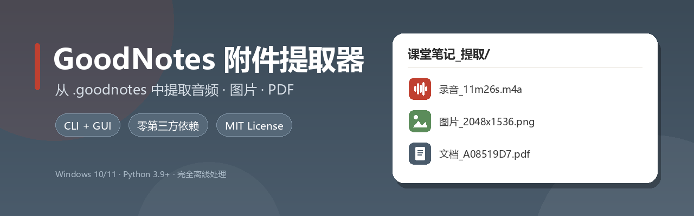
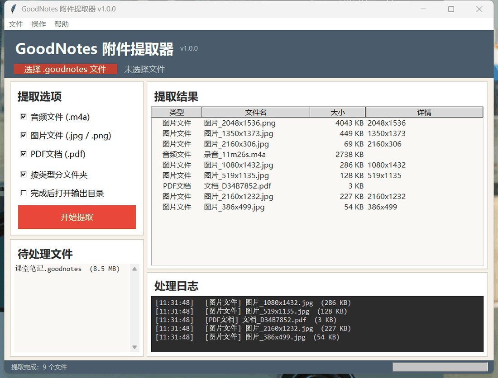

  

  <b>从 .goodnotes 里取出录音、图片和 PDF</b> 
  原名：基于协议缓冲区的笔记附件解析与还原系统

  
  
  
  
  
  

> **非官方工具声明**：本项目是独立的第三方工具，与 GoodNotes 的开发者
> Time Base Technology Limited 没有任何关联、赞助或背书。GoodNotes 是其所有者的
> 注册商标。本项目只处理**你本人拥有或已获授权**的文件，不包含、不破解 GoodNotes
> 的任何专有代码或资源。

  
   
  图形界面：文件列表、类型筛选、提取结果与日志

## ✨ 功能

<table>
  <tr>
    <td align="center" width="33%">🎧 <b>音频提取</b> M4A / AAC 自动解析时长与采样率</td>
    <td align="center" width="33%">🖼️ <b>图片提取</b> JPEG / PNG 按分辨率自动命名</td>
    <td align="center" width="33%">📄 <b>PDF 提取</b> 保留原始文档 按 UUID 前缀命名</td>
  </tr>
  <tr>
    <td align="center">📦 <b>批量处理</b> 递归扫描目录 一次处理多个笔记</td>
    <td align="center">🖥️ <b>双模式</b> 图形界面 + 命令行 满足不同使用习惯</td>
    <td align="center">🔒 <b>完全离线</b> 零网络请求 零第三方依赖</td>
  </tr>
</table>

## 🎯 它解决什么问题

GoodNotes 导出的 <code>.goodnotes</code> 是一个 ZIP 容器，附件在 <code>attachments/</code> 下，
文件名通常是一串 UUID。直接解压后，你很难知道哪个文件是录音、哪个是图片。

| 直接解压 <code>.goodnotes</code> | 使用本工具之后 |
| --- | --- |
| <code>attachments/4F2A9C...</code>（无扩展名） | <code>音频/录音_11m26s.m4a</code> |
| <code>attachments/A08519...</code>（无扩展名） | <code>图片/图片_2048x1536.png</code> |
| <code>attachments/D34B78...</code>（无扩展名） | <code>文档/文档_D34B7852.pdf</code> |

工具会读取文件头识别真实类型，解析 MP4 / JPEG / PNG / PDF 元数据，
再生成人类可读的文件名，并按类型分文件夹存放。

## 🚀 快速开始

### 方式一：下载可执行文件（推荐，免安装）

1. 打开 [Releases](https://github.com/ou0826/goodnotes-attachment-extractor/releases)；
2. 下载最新的 <code>GoodNotes-Attachment-Extractor-vX.Y.Z-win64.exe</code>；
3. 双击运行，或执行 <code>GoodNotes-Attachment-Extractor-vX.Y.Z-win64.exe --gui</code>。

<b>Windows 提示"已保护你的电脑"怎么办？</b>

发布版 exe 没有购买代码签名证书，SmartScreen 可能拦截。
点击「更多信息 → 仍要运行」即可。如果不放心，可以从源码运行或自行构建。

### 方式二：从源码安装

~~~bash
git clone https://github.com/ou0826/goodnotes-attachment-extractor.git
cd goodnotes-attachment-extractor
python -m pip install -e .
~~~

安装后得到两个命令：

~~~bash
gn-extract        # 命令行
gn-extract-gui    # 图形界面
~~~

不安装也能运行：

~~~bash
# Windows PowerShell
$env:PYTHONPATH="src"; python -m goodnotes_extractor --gui

# macOS / Linux
PYTHONPATH=src python -m goodnotes_extractor --gui
~~~

<b>方式三：自己构建 Windows exe</b>

~~~bash
python -m pip install -e ".[dev]"
python scripts/build_exe.py
~~~

产物：<code>dist/GoodNotes-Attachment-Extractor.exe</code>。

## 🖥️ 使用

### 图形界面

~~~bash
gn-extract-gui
~~~

1. 点击「选择文件」加载 <code>.goodnotes</code>，或点击「选择目录（批量）」递归扫描文件夹；
2. 在左侧勾选要提取的类型（音频 / 图片 / PDF）；
3. 点击「开始提取」，右侧表格显示结果，底部显示进度和日志；
4. 勾选「完成后打开输出目录」可在结束后自动打开文件夹。

### 命令行

~~~text
gn-extract <文件.goodnotes> [输出目录]    # 提取单个文件
gn-extract --gui                          # 启动图形界面
gn-extract --batch <目录> [输出目录]      # 批量提取
gn-extract --info <文件.goodnotes>        # 仅查看元数据
~~~

| 选项 | 说明 |
| --- | --- |
| <code>--gui</code> | 启动图形界面 |
| <code>--batch &lt;目录&gt;</code> | 批量处理目录中所有 <code>.goodnotes</code> |
| <code>--info &lt;文件&gt;</code> | 显示元数据，不导出附件 |
| <code>--no-audio</code> / <code>--no-image</code> / <code>--no-pdf</code> | 跳过对应类型 |
| <code>--no-organize</code> | 不按类型分文件夹 |
| <code>-v, --version</code> | 显示版本号 |
| <code>-h, --help</code> | 显示帮助 |

~~~bash
# 提取到默认目录（源文件同级的「笔记名_提取」）
gn-extract 汽车工艺学复习.goodnotes

# 指定输出目录，只导出音频
gn-extract 笔记.goodnotes D:导出 --no-image --no-pdf

# 批量处理整个文件夹
gn-extract --batch D:GoodNotes备份

# 查看一个文件里都有什么
gn-extract --info 笔记.goodnotes
~~~

### 输出结构

~~~text
笔记名_提取/
├── 音频/
│   └── 录音_11m26s.m4a
├── 图片/
│   └── 图片_2048x1536.png
└── 文档/
    └── 文档_A08519D7.pdf
~~~

- 音频：<code>录音_&lt;时长&gt;.m4a</code>
- 图片：<code>图片_&lt;宽&gt;x&lt;高&gt;.&lt;扩展名&gt;</code>
- PDF：<code>文档_&lt;原附件 UUID 前 8 位&gt;.pdf</code>
- 同名文件自动追加 <code>_1</code>、<code>_2</code>，不会覆盖已有文件。

> 图形界面指定了输出目录时，会再加一层笔记名：
> <code>&lt;输出目录&gt;/&lt;笔记名&gt;/音频/...</code>

## 🔍 工作原理

~~~mermaid
flowchart LR
    A[".goodnotes ZIP 容器"] --> B["读取 attachments/"]
    B --> C{"魔术字节识别"}
    C -->|M4A / AAC| D["音频/录音_11m26s.m4a"]
    C -->|JPEG / PNG| E["图片/图片_2048x1536.png"]
    C -->|PDF| F["文档/文档_D34B7852.pdf"]
    D --> G["按类型归档"]
    E --> G
    F --> G
~~~

- 只用 Python 标准库，不依赖第三方二进制解析库；
- 不做解密，也不绕过任何技术保护措施，只读取未加密的 ZIP 容器；
- 详细模块说明见 [docs/design.md](docs/design.md)。

## ❓ 常见问题

<b>提取结果里没有音频？</b>

请确认导出时勾选了"包括录音和音频"（或类似选项），并检查界面左侧是否勾选了音频类型。

<b>导出的 M4A 在部分播放器里打不开？</b>

部分录音的 <code>moov</code> 原子位于文件尾部，个别播放器兼容性较差。可以用 VLC 播放，
或使用 ffmpeg 转成 WAV/MP3：

~~~bash
ffmpeg -i 录音_11m26s.m4a 录音.wav
~~~

<b>会修改或删除我的原始 .goodnotes 文件吗？</b>

不会。程序以只读方式打开 ZIP 容器，只在输出目录中新建文件。

<b>会把我的笔记上传到服务器吗？</b>

不会。程序没有任何网络请求、没有遥测、没有账号系统，所有处理都在本机完成。

<b>支持 GoodNotes 的哪个版本？</b>

主要针对 GoodNotes 5 导出的 <code>.goodnotes</code> 格式开发与测试。其他版本如遇问题，
欢迎提交 Issue 并附上（脱敏后的）目录结构，**不要上传包含个人内容的原始笔记**。

<b>为什么仓库里没有示例 .goodnotes 文件？</b>

示例文件会包含真实笔记与个人信息，因此不随仓库分发。测试请使用你自己的文件。

## 🔒 隐私

- 无网络请求、无遥测、无账号系统；
- 配置文件：<code>~/.goodnotes-extractor/config.json</code>
- 日志文件：<code>~/.goodnotes-extractor/logs/</code>（自动轮转，最多保留 10 个）

提交 Issue 前请删除日志中的个人路径、文件名等信息。

## 🗂️ 项目结构

<b>展开查看</b>

~~~text
.
├── src/goodnotes_extractor/
│   ├── __init__.py       版本与包元信息
│   ├── __main__.py       python -m goodnotes_extractor 入口
│   ├── cli.py            命令行入口、单文件提取
│   ├── gui.py            Tkinter 图形界面
│   ├── parser.py         MP4/JPEG/PNG/PDF 二进制解析
│   ├── classifier.py     魔术字节类型识别
│   ├── metadata.py       Protobuf 索引解码
│   ├── batch.py          批量处理与去重
│   ├── converter.py      可选格式转换（库 API）
│   ├── config.py         配置管理
│   └── logger.py         日志管理
├── tests/                74 个单元测试（unittest / pytest）
├── docs/                 使用说明、架构文档、发布指南
├── scripts/build_exe.py  PyInstaller 构建脚本
└── .github/workflows/    CI 与自动发布
~~~

## 🛠️ 开发与测试

~~~bash
python -m pip install -e ".[dev]"

pytest                          # 或
python -m unittest discover -s tests -v

python scripts/build_exe.py     # 构建 Windows exe
~~~

提交 PR 前请确保测试全部通过。详细规范见 [CONTRIBUTING.md](CONTRIBUTING.md)。

## 🤝 参与贡献

欢迎提交 Issue 和 Pull Request：

- **Bug**：使用 Bug Report 模板，附上系统版本、复现步骤和脱敏后的日志；
- **功能建议**：使用 Feature Request 模板，说明使用场景；
- **安全问题**：请勿公开提交，按 [SECURITY.md](SECURITY.md) 私下联系。

参与本项目即表示你同意遵守 [CODE_OF_CONDUCT.md](CODE_OF_CONDUCT.md)。

## 📄 许可证

本项目采用 [MIT License](LICENSE) 开源。你可以自由使用、修改、分发，
包括商业用途，但需保留版权声明和许可证文本。

本项目已申请软件著作权。

第三方组件与商标声明见 [NOTICE](NOTICE)。

## ⚠️ 免责声明

本软件按"原样"提供，不附带任何明示或暗示的担保。使用本软件造成的任何数据丢失、
文件损坏或其他损失，作者不承担责任。请在使用前备份重要笔记。

本项目与 Time Base Technology Limited 无任何关联。GoodNotes 是其注册商标。

---

  如果这个项目帮到了你，欢迎点一个 ⭐ Star

